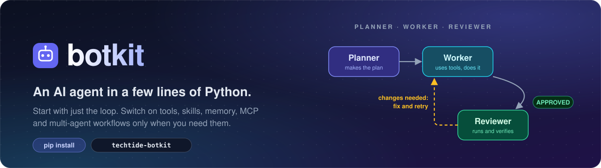

<div align="center">



<br>

[](https://pypi.org/project/techtide-botkit/)
[](https://pypi.org/project/techtide-botkit/)
[](LICENSE)
[](#-memory)
[](#-providers)

**[Install](#-install)** · **[Quick start](#-quick-start-in-60-seconds)** · **[Multi-agent](#-multi-agent-workflows)** · **[Tools](#-bundled-tools-17)** · **[Memory](#-memory)** · **[Limits & resume](#-limits-fallback-and-resume)** · **[Deploy](#-deploying)** · **[FAQ](#-faq)**

</div>

---

## 🤔 What is botkit?

**botkit is a Python library that adds an AI agent to your project in a few lines.**

A normal chatbot only answers with text. An **agent** can also *do things*: read and write files, make Word / Excel / PowerPoint / PDF documents, search the web, do exact maths, run code and check the result, remember the user between sessions, and even work as a **team** (a planner, a worker and a reviewer who sends the work back until it is right).

botkit gives you all of that behind one simple idea:

> **Simple outside, complicated inside.** By default you get *only the loop*. Everything else is a flag you switch on when you need it.

```python
from botkit import BotKit

bot = BotKit("groq:openai/gpt-oss-120b")     # your model, your API key (from the environment)
print(bot.chat("Hello!"))
```

That is a complete chatbot: model calls, retries, error handling, conversation history. No setup, no config files.

### Who is it for?

- **Developers** who want an assistant inside their Flask / Django / FastAPI / Node app without learning a big framework.
- **Students and builders** who want to understand and control every part (the whole library is small and readable).
- **Teams** who need to choose their own model provider, their own database, and their own security rules.

### What can I build with it?

| Idea | Switch on |
|---|---|
| A support or FAQ chatbot for your website | `BotKit(model, rules=[...], memory="chat.db")` + `bot.serve()` |
| An assistant that writes reports, decks and spreadsheets | `tools=True` |
| A coding helper that writes code, runs it and checks the output | `tools=True, shell="docker"` |
| A research team (several researchers at once, then one writer) | `mode="parallel"` |
| A "does it right" workflow where work is reviewed and fixed | `multi_agent=True` |
| A bot that remembers each user | `memory=SupabaseStorage()`, one `session` per user |

## ✨ Why botkit?

| | |
|---|---|
| 🧩 **Loop only by default** | Nothing you did not ask for is switched on. Easy to understand, easy to debug. |
| 🎛️ **Everything is a flag** | `tools=`, `skills=`, `memory=`, `mcp=`, `shell=`, `rules=`, `multi_agent=` ... |
| 🛠️ **17 ready tools** | Files, Word/Excel/PowerPoint/PDF, web, calculator, shell. Grouped by purpose. |
| 🧠 **10 ready skills** | Research, planning, coding, debugging, writing... Loaded by the model only when needed. |
| 💾 **Your database** | SQLite out of the box, Supabase, or any database you write in one small class. |
| 👥 **Multi-agent** | Sequential, parallel or custom graphs. A reviewer that *verifies*, not just reads. |
| 🔌 **Any model** | Groq, OpenAI, DeepSeek, Claude, Gemini, OpenRouter, Mistral, Together, Ollama, or your own server. Mix models per agent. |
| 🔒 **Security in code** | Workspace confinement, secret redaction, blocked internal URLs, and rules that can never loosen security. |
| 🔍 **See what happened** | Built-in trace of every model call, tool call and graph step. |
| 🧪 **Testable** | `FakeLLM` lets you test agents and whole workflows without a real model. |
| 🚀 **Deployable** | `botkit init` writes a Dockerfile, compose file and an app. One command to serve an HTTP API. |

---

## 📦 Install

```bash
pip install techtide-botkit              # the loop only (needs just `openai`)
pip install "techtide-botkit[docs]"      # + Word / Excel / PowerPoint / PDF tools
pip install "techtide-botkit[mcp]"       # + MCP servers
pip install "techtide-botkit[all]"       # everything
```

> The package is named `techtide-botkit` on PyPI; you import it as `botkit`.

Set the key of the provider you use (or pass `api_key="..."` in code):

```bash
export GROQ_API_KEY="..."         # or OPENAI_API_KEY, DEEPSEEK_API_KEY, ANTHROPIC_API_KEY, GEMINI_API_KEY, OPENROUTER_API_KEY
```

On Windows PowerShell use `$env:GROQ_API_KEY="..."`.

## 🚀 Quick start in 60 seconds

```python
from botkit import BotKit

MODEL = "groq:openai/gpt-oss-120b"        # "provider:model". Model names change, check your provider's list.

bot = BotKit(MODEL)                        # 1. just the loop
print(bot.chat("Explain recursion in one sentence"))

bot = BotKit(MODEL, tools=True, memory="bot.db")      # 2. + tools + memory that survives restarts
bot.run()                                  # chat in the terminal (type exit to quit)

team = BotKit(MODEL, multi_agent=True, tools=True)    # 3. a planner -> worker -> reviewer team
print(team.chat("Write a one-page launch plan and save it as plan.docx"))
```

Files the bot creates are saved in the `workspace/` folder next to your script (change it with `workdir="..."`).

### Choose your level

```
single agent  ->  + tools  ->  + memory  ->  sequential team  ->  parallel team  ->  your own graph
 BotKit(m)      tools=True    memory="x.db"   multi_agent=True    mode="parallel"    graph=my_graph
```

You decide how far to go. botkit never switches on a multi-agent graph unless you ask for one.

## 🧭 Which loop do I get?

| You write | You get |
|---|---|
| `BotKit(model)` | one agent loop (default) |
| `BotKit(model, multi_agent=True)` | planner → worker → reviewer; the reviewer sends work back until approved |
| `BotKit(model, review=True)` | worker + reviewer correction loop |
| `BotKit(model, mode="sequential", agents=[...])` | agents one after another |
| `BotKit(model, mode="parallel", agents=[...], merge="synthesizer")` | agents at the same time, results merged |
| `BotKit(graph=g)` | your own graph (branching, loops) |

`BotKit(...)` returns an `Agent` (single mode) or a `Graph` (multi-agent modes). Both are used the same way: `chat`, `stream`, `achat`, `astream`, `run`, `serve`, `fork`, `close`. The older `Agent(...)` still works.

## 👥 Multi-agent workflows

```python
from botkit import Agent, BotKit, Graph, chain, parallel, END

# 1) A chain, with a different model per agent
planner  = Agent("openai:gpt-4o-mini",      name="planner",  system="Make a short plan.")
worker   = Agent("deepseek:deepseek-chat",  name="worker",   tools=True)
reviewer = Agent("claude:claude-sonnet-4-5", name="reviewer")
team = chain(planner, worker, reviewer, review=True)      # same as planner | worker | reviewer, plus a correction loop
print(team.chat("Write a short report on electric scooters"))

# 2) Parallel: all at once, then merged
research = BotKit(MODEL, mode="parallel", agents=["researcher", "researcher", "critic"], merge="synthesizer", tools=["web"])

# 3) Custom graph: nodes are agents, functions or other graphs; edges can be conditional
g = Graph(max_steps=25)
g.add(lambda s: "code" if "bug" in s.task else "text", name="router")
g.add(coder); g.add(writer)
g.edge("router", coder, when=lambda s: s.last == "code")   # first matching condition wins
g.edge("router", writer)                                    # default branch
g.edge(coder, END)
```

`agents=[...]` accepts `Agent` objects, role names (`"planner"`, `"worker"`, `"reviewer"`, `"researcher"`, `"writer"`, `"critic"`, `"synthesizer"`), `"provider:model"` strings, or dicts such as `{"role": "worker", "model": "deepseek:deepseek-chat", "tools": True}`.

**How the engine works:** nodes of the same level run at the same time; a node receives the task plus the outputs of the nodes feeding it; a node with conditional edges branches (first match wins, unconditional edges are the default); a node with no edge to follow ends the run and its output is the answer.
**Loops are always bounded:** `max_steps` node runs per run (default 25), `max_visits` per node (default 10), and a node that repeats its previous output without using any tool stops the loop.

### Who gets which tools?

Tools come from the app's `tools=` / `skills=` / `shell=` flags, narrowed by role:

| Role | Tool categories | Skills |
|---|---|---|
| planner | inspect, web, compute (looks, never changes anything) | planning |
| worker | everything the app enabled | all |
| reviewer | inspect, compute, web, **run** (if you gave a shell). Never edits | verify-work |
| researcher | inspect, web, compute | research |
| writer | inspect, edit, documents | writing-documents |
| critic | inspect, compute | none |
| synthesizer | none (it only merges text) | none |

The **reviewer verifies instead of trusting**: it opens the real files, recomputes numbers and, if you gave `shell=`, runs the code or tests and reads the output before saying `APPROVED` or `CHANGES NEEDED`.
`BotKit(..., role_tools=False)` gives every agent everything instead. Agents added as a plain model (`agents=["groq:other-model"]`) or as a dict inherit the app's tools; keys in the dict win.

Good to know:
- Agents in a graph start every visit with a clean slate. The graph itself keeps the conversation (`memory=`).
- Agents running side by side in the same workspace automatically get their own sub-folders.
- `on_error="continue"` (default for parallel) turns a failed branch into error text instead of stopping the run.
- A `Graph` is served, forked per user, streamed and closed exactly like an `Agent`.
- A team makes several model calls per task. For small jobs, a single agent is faster and cheaper.

## 🛠️ Bundled tools (17)

| Category | Tools | For |
|---|---|---|
| 🔎 `inspect` | `list_files` `read_file` (also .docx/.xlsx/.pptx; can read a slice with `start`/`lines`) `search_files` `tree` `file_info` | look at what exists (read-only) |
| ✏️ `edit` | `write_file` `edit_file` | create and change files |
| 📄 `documents` | `create_docx` `create_xlsx` `create_pptx` `create_pdf` | office and PDF files |
| 🌐 `web` | `fetch_url` `web_search` (DuckDuckGo scraping, may be rate-limited) | read the internet |
| 🧮 `compute` | `calculate` `current_time` | exact maths, the date |
| 💻 `run` | `run_command` `run_python` (only with `shell=`) | run programs and tests, read their output |

```python
BotKit(model, tools=True)                          # all (the `run` tools also need shell=)
BotKit(model, tools=["inspect", "web"])            # whole categories
BotKit(model, tools=["read_file", "calculate"])    # single tools
BotKit(model, tools=["inspect", my_function])      # mix with your own
```

Each agent's prompt lists its tools by purpose, so the model picks the right kind of tool. The older group names (`files`, `docs`, `util`, `shell`) still work.

**Your own tool:** put `@tool` on a function. Type hints and the docstring become the schema.

```python
from botkit import BotKit, tool

@tool
def order_status(order_id: str) -> str:
    """Look up an order.

    Args:
        order_id: The order number.
    """
    return "shipped"

bot = BotKit(MODEL, tools=["files", "calculate", order_status])
```

## 🧠 Bundled skills (10)

`research` · `planning` · `verify-work` · `writing-documents` · `presentations` · `spreadsheets` · `data-analysis` · `coding` · `debugging` · `summarizing`

Only each skill's name and one-line description go into the prompt; the model loads the full text with `load_skill` when a task matches, so skills cost almost no context. Your own skills are folders with a `SKILL.md` (frontmatter `name` and `description`, then the instructions): `BotKit(model, skills=[True, "my_skills/"])`.

## 💾 Memory

Memory is the conversation history (survives restarts) plus long-term facts (`remember` / `recall` / `forget` tools). It sits on a `Storage` backend, so the database is your choice.

```python
BotKit(model, memory="bot.db")                        # SQLite (zero setup)
BotKit(model, memory=SupabaseStorage())               # Supabase
BotKit(model, memory=MyStorage())                     # anything you write
BotKit(model, memory="bot.db", session="user42")      # one session per user, same database
```

Without `memory=`, the bot still remembers the conversation while the program runs; it just forgets on restart.

<details>
<summary><b>Supabase setup</b></summary>

Run this once in the Supabase SQL editor (`botkit sql` prints it too, grants included), then set `SUPABASE_URL` and `SUPABASE_KEY` to your project URL and the **secret / `service_role`** key (server side only, never the anon or publishable key, never in a browser):

```sql
create table if not exists botkit_messages (
  id bigint generated always as identity primary key,
  session text not null, data jsonb not null, created_at timestamptz not null default now());
create index if not exists botkit_messages_session_idx on botkit_messages (session, id);
create table if not exists botkit_facts (
  id bigint generated always as identity primary key,
  session text not null, text text not null, created_at timestamptz not null default now());
create index if not exists botkit_facts_session_idx on botkit_facts (session, id);
alter table botkit_messages enable row level security;
alter table botkit_facts enable row level security;
grant usage on schema public to service_role;
grant all on table public.botkit_messages to service_role;
grant all on table public.botkit_facts to service_role;
grant usage, select on all sequences in schema public to service_role;
```

```python
from botkit import BotKit, SupabaseStorage
store = SupabaseStorage(url="https://YOUR-PROJECT.supabase.co", key="...")   # or read from the environment
bot = BotKit(MODEL, memory=store, session="ahmed")
```
</details>

<details>
<summary><b>Your own tables, and any other database</b></summary>

```python
db = SQLiteStorage("bot.db", extra_schema="CREATE TABLE IF NOT EXISTS orders(id INTEGER PRIMARY KEY, item TEXT)")
db.execute("INSERT INTO orders(item) VALUES(?)", ("tea",));  db.query("SELECT * FROM orders")

store = SupabaseStorage()
store.table("orders").insert({"item": "tea"});  store.table("orders").select({"item": "tea"}, order="id.desc")
```

Wrap these calls in `@tool` functions to let the bot use them (`examples/memory_backends.py`).

**Any other database** (MongoDB, Postgres, Redis...): subclass `Storage` and implement 6 methods: `add_messages`, `get_messages`, `clear_messages`, `add_fact`, `list_facts`, `delete_fact`. `examples/custom_storage.py` is a complete template.
</details>

## 🔌 MCP

```python
BotKit(model, mcp="npx -y @modelcontextprotocol/server-filesystem .")    # local server
BotKit(model, mcp="https://example.com/mcp")                              # remote server
BotKit(model, mcp="mcp.json")                                             # Claude-Desktop style config
```

Needs `pip install "techtide-botkit[mcp]"`. A server that fails to start is skipped with a warning instead of crashing the bot. In a team, MCP servers are shared and started once.

## 🔒 Rules and security

```python
BotKit(model, rules=["Reply in Urdu", "Never discuss pricing"])           # or rules="rules.txt"
BotKit(model, tools=True, shell="docker", deny=[r"git push", r"pip install"])
BotKit(model, tools=True, shell="local", approve=lambda name, args: input(f"Run {args['command']}? ") == "y")
```

Your rules go into the prompt, but the **security rules always come last and cannot be loosened**. The real enforcement is in code, not in the prompt:

- 📁 File tools and the shell are confined to the workspace folder (`..`, absolute paths and symlinks are refused).
- 💻 There is **no shell** unless you choose one in code: `"local"` (workspace only, API keys hidden, dangerous commands blocked; a speed bump, **not** a jail) or `"docker"` (throwaway container: no network, read-only root, memory and CPU limits). Use Docker for anyone you do not fully trust.
- 🔑 API keys and tokens are redacted from anything a tool returns to the model.
- 🌐 `fetch_url` and `web_search` refuse private and internal addresses, also after redirects.
- 🧱 Tool output and web pages are marked as untrusted data (prompt-injection defence).
- ♻️ Tool errors, bad JSON, timeouts and repeated calls are fed back to the model so it can recover. API errors (429, 5xx) are retried with backoff.

## 🔌 Providers

`"provider:model"` works for any OpenAI-compatible API: `groq`, `openai`, `openrouter`, `gemini`, `deepseek`, `claude` (Anthropic's OpenAI-compatible endpoint), `mistral`, `together`, `ollama`, `local` (LM Studio / vLLM). Different agents can use different providers.

```python
BotKit("my-model", base_url="http://127.0.0.1:8000/v1", api_key="anything")     # your own server
register_provider("mycorp", "https://llm.corp/v1", "CORP_KEY")                  # add a provider name
```

`botkit providers` lists them with their key variables. A server that cannot stream falls back to normal replies automatically.

## 🛟 Limits, fallback and resume

Long jobs hit walls: a daily quota, a rate limit, a provider outage. botkit handles all three, in the single agent loop and in graphs.

**1. Fallback models.** If a model fails, the *same request* goes to the next one and the work keeps going.

```python
bot  = BotKit("deepseek:deepseek-chat", fallback=["groq:openai/gpt-oss-120b", "claude:claude-sonnet-4-5"])
team = BotKit("groq:openai/gpt-oss-120b", multi_agent=True, fallback=["openai:gpt-4o-mini"])   # every agent gets it
coder = Agent("deepseek:deepseek-chat", fallback="groq:openai/gpt-oss-120b")                   # or per agent
```

A model that just failed is skipped for a while (as long as the provider said, or 2 minutes; 10 minutes for a quota) and then tried again. Switches show up in the trace as `fallback` events. A fallback whose API key is missing is skipped, never fatal.

**2. Limits are understood.** A *short* rate limit (per minute) is retried with backoff. A *hard* limit (daily quota, no credit, "try again in 12 minutes") is **not** retried: botkit fails over at once instead of sleeping. `LLMError.kind` tells you which it was (`quota`, `rate_limit`, `server`, `network`, `auth`, `exhausted`) and `LLMError.retry_after` says how many seconds to wait.

**3. Nothing is lost: resume.** If every model fails, the work already done is kept.

```python
try:
    bot.chat("Build the report and save it as report.docx")
except LLMError as e:
    print(e.kind, e.retry_after)        # e.g. quota 758.0  ->  come back later

bot.interrupted      # True
bot.resume()         # continues from where it stopped: finished tool calls are not repeated
```

- **Agent loop:** with `memory=` the interrupted turn is saved, so `resume()` works even after a restart.
- **Graph / team:** the run is saved when a node fails; `team.resume()` runs only the failed node and what comes after it. Nodes that already finished are not paid for twice, also not the finished branches of a parallel level. Add `checkpoint="run.json"` to keep that state on disk across restarts.
- **Terminal chat:** type `/resume`.
- Not covered: with `on_error="continue"` (the default of parallel mode) a failed branch becomes error text instead of pausing the run; give those agents a `fallback`.

```python
team = BotKit(MODEL, multi_agent=True, tools=True, checkpoint="run.json", fallback=["groq:llama-3.3-70b-versatile"])
try:
    team.chat("Write the launch plan")
except LLMError:
    ...                      # all models are limited right now
# ...hours later, or after a restart:
print(team.resume())
```

## ⚡ Streaming, async and the HTTP server

```python
for piece in bot.stream("tell me a story"): print(piece, end="")     # sync generator
async for piece in bot.astream("..."): ...                           # async generator
answer = await bot.achat("...")                                      # async call
bot.chat("...", on_token=print)                                      # or a callback

bot.serve(host="0.0.0.0", port=8000, token="change-me", cors_origins=["https://myapp.com"])
```

```
POST /chat   {"message": "make a budget sheet", "session": "user42"}
GET  /files/<session>/<path>       download a file the bot created
GET  /health                       {"ok": true, "version": "..."}
```

Each `session` is a separate user with its own history, facts and workspace folder. Listening on a public address without a `token` is refused. Any language (JavaScript, mobile, ...) can use botkit through this API.

## 🔍 Watching and testing

```python
bot = BotKit(model, multi_agent=True)        # graphs keep a trace; for a single agent use trace=True
bot.chat("...")
bot.trace.print()          # timeline: model calls, tool calls, nodes, edges, errors
bot.trace.summary()        # counts, seconds, tokens, tool errors
bot.trace.flow()           # ['planner', 'worker', 'reviewer']
```

The same events go to Python's `logging` (logger name `"botkit"`). Test without a real model:

```python
from botkit import Agent, chain
from botkit.testing import FakeLLM, say, call, assert_flow, assert_tools_called

planner = Agent(name="planner", llm=FakeLLM(say("plan")))
worker  = Agent(name="worker",  llm=FakeLLM(say("done")))
g = chain(planner, worker)
assert g.chat("go") == "done"
assert_flow(g, ["planner", "worker"])
```

## 🚀 Deploying

```bash
botkit init              # writes app.py, Dockerfile, docker-compose.yml, .env.example, requirements.txt, .gitignore
cp .env.example .env     # add your key and BOTKIT_TOKEN
docker compose up --build
```

The server reads `BOTKIT_HOST`, `PORT`, `BOTKIT_TOKEN` and `BOTKIT_CORS` from the environment, shuts down cleanly on `docker stop`, and `GET /health` returns the version. Put memory (`./data`) on a volume, or use Supabase.

Other commands: `botkit chat` (terminal chat), `botkit sql` (Supabase SQL), `botkit providers`, `botkit version`.

## 🎛️ All flags

| Flag | Default | What it does |
|---|---|---|
| `tools=` | off | `True`, categories, tool names, your own functions, or a mix |
| `skills=` | off | `True`, one by name, a folder of your own, `Skill(...)`, or a mix |
| `memory=` | off (RAM only) | `"bot.db"`, `SupabaseStorage()`, your own `Storage`, `Memory(...)` |
| `session=` | `"default"` | one conversation per user inside the same memory |
| `mcp=` | off | command string, URL, `MCP(...)`, list, or an `mcpServers` JSON file |
| `shell=` | off | `"local"`, `"docker"`, a dict, or a `Sandbox`. Turns on `run_command` and `run_python` |
| `rules=` | none | string, list, or a text file added to the prompt |
| `workdir=` | `workspace/` | the only folder the file tools and shell can touch |
| `multi_agent=` `mode=` `agents=` `graph=` `review=` | off | multi-agent workflows |
| `role_tools=` | `True` | `False` gives every agent in a team all tools |
| `trace=` | off (graphs: on) | record every model call, tool call and error |
| `max_steps=` | 12 | model calls per turn (a final answer is forced at the limit) |
| `max_context_tokens=` | 24000 | estimated token budget for old turns |
| `approve=` `deny=` `policy=` | none | control which shell commands may run |
| `fallback=` | none | other models to switch to on a limit or outage: `"provider:model"` or a list |
| `checkpoint=` | none | graphs: JSON file where an interrupted run is saved for `resume()` |
| `api_key=` `base_url=` `llm=` | from environment | provider key, endpoint, or your own client object |

## ❓ FAQ

**Do I need an API key?** Yes, from the provider of the model you pick (Groq has a free tier). Local models through Ollama or LM Studio need none.

**Which models work?** Any model behind an OpenAI-compatible API. It has been tested with Groq and with a local OpenAI-compatible server; other providers use the same protocol but are less tested. For tools to work, the model must support function calling.

**Is it safe to let the bot run commands?** Only if you choose to. There is no shell by default. `shell="local"` is for your own machine and a trusted user; for anyone else use `shell="docker"` or no shell.

**Does it work from JavaScript or other languages?** The library is Python. Other languages talk to it through the built-in HTTP server (`bot.serve()`).

**Why did my team take 30 seconds?** Each agent makes its own model calls, and review loops repeat work. Use a single agent for simple tasks, a faster model for planner and reviewer, or `review=True` without the planner.

**What happens when my API limit runs out mid-task?** botkit switches to your `fallback=` models, and if all are limited it stops with the work kept; `resume()` continues later. See *Limits, fallback and resume*.

**Is it free?** Yes, MIT licensed. You only pay your model provider.

## 📁 Project structure

```
botkit/
├── pyproject.toml  README.md  CHANGELOG.md
├── assets/banner.svg
├── botkit/
│   ├── kit.py          BotKit: one entry point, picks single or graph mode from flags
│   ├── agent.py        the loop (Agent)
│   ├── graph.py        multi-agent engine: Graph, chain, parallel, roles
│   ├── llm.py          providers, streaming, retries, fallback models
│   ├── trace.py        events, timings, logging
│   ├── testing.py      FakeLLM and assertions
│   ├── cli.py          botkit init | chat | sql | providers
│   ├── tool.py  skill.py  mcp.py  security.py  sandbox.py  server.py  errors.py
│   ├── memory/         Storage base, SQLite, Supabase, Memory
│   ├── tools/          files.py docs.py web.py shell.py util.py
│   └── skills/         10 folders, each with a SKILL.md
├── examples/
└── tests/
```

## 🗺️ Roadmap

- [ ] Postgres / Neon and MongoDB backends in the box
- [ ] File storage backends (S3, Supabase Storage)
- [ ] Image input
- [ ] Exact token counting (counts are estimates today)
- [ ] Scheduled tasks
- [ ] Background job queue helpers (Celery / Redis recipes)

## 🧪 Development

```bash
git clone https://github.com/life2-byte/botkit.git
cd botkit
pip install -e ".[dev]"
pytest
```

## 📄 License

MIT. See the `LICENSE` file.

---

<div align="center">

Built by **Ahmed** at **Techtide** · If botkit helped you, give it a ⭐

</div>